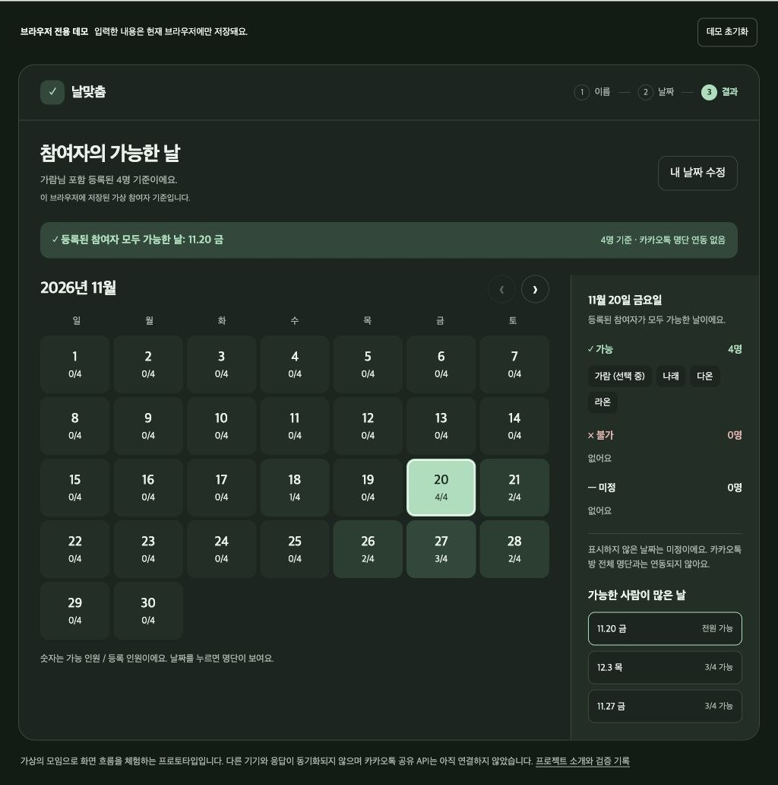
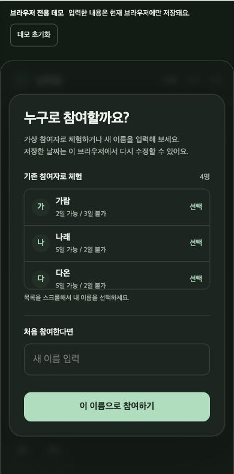
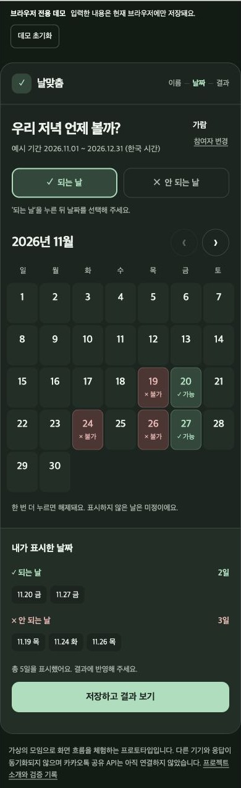
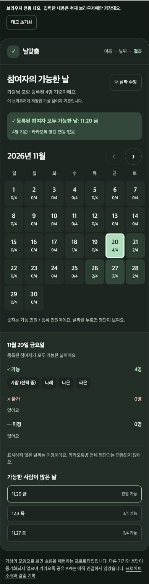

# 날맞춤

**카카오톡에서 시작한 약속, 달력 한 장으로 가능한 날을 모으는 실험.**

[직접 눌러보는 데모](https://dorkem.github.io/nalmatch/) · [카카오톡 공유 설계](docs/kakao-sharing.md) · [검증 기록](docs/validation.md)

> **현재 단계: 반응형 프론트엔드 프로토타입**
>
> 이름 입력 → 가능·불가 날짜 표시 → 참여자별 결과 취합을 체험할 수 있습니다. 입력은 **현재 브라우저에만 저장**되며, 다른 사람·기기와의 동기화와 카카오 API 연결은 구현 전입니다.

[](https://dorkem.github.io/nalmatch/)

*화면을 누르면 실행 가능한 데모로 이동합니다. GitHub README는 [실행 스크립트를 제한](https://github.com/github/markup#github-markup)하므로 GitHub Pages로 연결합니다. 캡처는 2026년 11월의 예시이며, 실제 화면은 현재 월을 기준으로 열립니다.*

## 대화 속에 흩어진 가능 날짜를 다시 모아야 했다

카카오톡에서 여러 사람과 약속을 잡을 때, 각자 말한 가능한 날과 불가능한 날을 되짚어 정리하는 과정이 번거로웠습니다. 이 프로젝트는 이 **개인적인 문제 관찰**에서 시작했습니다.

가상의 예를 들면 한 사람은 “토요일 가능”, 다른 사람은 “이번 주는 어렵고 다음 주 가능”이라고 말합니다. 누군가는 대화를 다시 읽고, 날짜별로 누가 가능한지 확인해야 합니다.

**탐색 조건은 앱 설치 없이 참여하기, 이름 직접 입력하기, 날짜로 응답하기, 카카오톡 투표 제외하기였습니다.** 아직 사용자 인터뷰를 통해 보편성이나 빈도를 검증한 문제는 아닙니다.

## 응답을 받는 일과 날짜별로 취합하는 일이 나뉘어 있었다

이번 탐색에서는 다음 두 작업에 집중했습니다.

- 참여자가 자신의 가능한 날을 전달하는 일
- 주최자가 사람별 응답을 날짜별로 다시 묶는 일

이미 존재하는 일정 조율 서비스와의 우열은 검증하지 않았습니다. 이 시제품은 익숙한 카카오톡에서 링크로 진입한 뒤, 날짜별 응답을 바로 정리하는 흐름을 확인하기 위한 것입니다.

## 달력에 가능·불가를 직접 표시하고 미정은 남겨둔다

1. 이름을 입력하거나 기존 가상 참여자를 선택합니다.
2. **되는 날 / 안 되는 날**을 선택한 뒤 달력의 날짜를 누릅니다.
3. **저장하고 결과 보기**를 누르면 날짜별 인원과 명단이 나타납니다.
4. 수정할 때는 기존 참여자의 응답을 불러옵니다.

| 이름 선택 | 날짜 입력 | 결과 확인 |
| --- | --- | --- |
|  |  |  |

판단 규칙도 화면에 드러냈습니다.

- 아무 표시가 없는 날짜는 **미정**입니다.
- 같은 상태로 다시 누르면 선택이 해제됩니다.
- ‘등록된 참여자 모두 가능’은 **이 웹에 등록된 인원 기준**입니다.
- 카카오톡방 전체 인원이나 아직 참여하지 않은 사람의 응답을 아는 것은 아닙니다.

## 현재 월부터 열고 지난달 날짜 응답은 정리한다

한국 시간(`Asia/Seoul`)의 **현재 월과 다음 월**을 표시합니다. 이전 달로는 이동하지 않습니다.

앱에 접속하거나 새로고침할 때 지난달 날짜 응답을 로컬 저장소에서 정리합니다. 기존 참여자 이름은 유지하고, 현재 월과 다음 월의 응답은 보존합니다. 월이 바뀐 뒤 탭으로 돌아오면 새 월을 반영합니다.

정적 프론트엔드이므로 앱을 열지 않은 동안 서버에서 주기적으로 삭제하는 구조는 아닙니다. 저장소가 차단된 환경에서는 화면에 저장 제한을 안내합니다.

## 작은 정적 앱으로 입력·수정·집계 규칙을 구현했다

| 구분 | 선택한 방식 | 판단 이유 |
| --- | --- | --- |
| 화면 | HTML, CSS, JavaScript | 달력 입력 흐름을 확인하는 데 프레임워크나 빌드 과정이 필요하지 않았습니다. |
| 이름 | 직접 입력 / 기존 이름 선택 | 로그인 단계 없이 첫 흐름을 체험하게 했습니다. |
| 저장 | 브라우저 `localStorage` | 서버 없이 시제품의 저장·재수정 흐름을 확인합니다. |
| 집계 | 날짜별 가능·불가·미정 계산 | 자연어 해석보다 명시적인 입력과 계산에 집중했습니다. |
| 배포 | GitHub Pages | 정적 파일을 바로 배포하고 포트폴리오에서 실행 화면으로 연결합니다. |

AI 도구와 함께 문제를 구체화하고 화면을 반복 개선했습니다. **현재 앱 자체에 AI 추론 기능은 없습니다.**

```text
index.html        화면 구조와 접근성 레이블
styles.css        모바일·PC 배치와 날짜 상태 표현
app.js            참여자 선택, 입력, 저장, 결과 화면 연결
core.js           날짜 범위, 지난달 정리, 응답 집계와 후보 정렬
tests/            집계·월 경계 규칙의 회귀 테스트
docs/             공유 방식과 검증 기록
```

## 카카오톡 공유는 모임별 링크와 공용 저장소로 연결할 계획이다

실제 여러 사람이 함께 사용하는 단계에서는 다음 흐름으로 확장합니다.

**모임 생성 → 모임 ID가 포함된 링크를 카톡에 공유 → 이름과 날짜 입력 → 공용 DB에 저장 → 같은 모임의 결과 조회**

일반 단톡방에 `/일정`을 입력해 실행하거나 카톡방 참여자 명단을 자동으로 불러오는 방식은 사용하지 않습니다. 모임 ID로 이름 목록과 응답 범위를 구분하고, 카카오톡 공유 API는 초대 링크를 전달하는 역할을 맡깁니다.

같은 링크를 여러 단톡방에 보내면 같은 모임으로 연결됩니다. 방마다 별도 취합이 필요하면 다른 모임 링크를 만들어야 합니다. 구체적인 API 제약과 다음 단계는 [공유 설계](docs/kakao-sharing.md)에 적었습니다.

## 검증한 동작과 앞으로 검증할 효과를 구분한다

집계 규칙과 월 경계 처리는 자동 테스트로 확인합니다. 실제 브라우저에서 수행한 화면 점검 범위와 결과는 [검증 기록](docs/validation.md)에 남깁니다.

| 현재 확인할 수 있는 것 | 아직 확인하지 않은 것 |
| --- | --- |
| 가능·불가·미정 집계의 일관성 | 기존 카카오톡 대화보다 조율 시간이 줄어드는지 |
| 기존 참여자 수정 시 중복 인원 방지 | 처음 보는 사람이 설명 없이 응답할 수 있는지 |
| 응답을 전부 해제한 뒤 다시 저장하기 | 로그인 없이 이름으로 참여할 때 혼동이 생기는지 |
| 월·연도 변경 시 지난달 응답 정리 | 여러 기기에서 공유 저장이 안정적으로 동작하는지 |

**성과 수치, 사용자 수, 시간 절감률은 아직 측정하지 않았습니다.** 다음 검증에서는 소규모 모임을 대상으로 기존 대화 방식과 비교해, 공통 날짜를 찾는 데 걸린 시간·응답 누락·수정 횟수를 기록할 계획입니다.

이 프로젝트에서 남긴 결과는 **문제 관찰을 입력 흐름으로 구체화하고, API 제약에 맞춰 범위를 정하며, 실행 가능한 시제품과 검증 기준을 만든 것**입니다.

## 로컬에서 실행하기

의존성 설치나 빌드가 필요하지 않습니다.

```bash
python3 -m http.server 8000
```

브라우저에서 `http://localhost:8000`을 엽니다. JavaScript 모듈을 사용하므로 파일을 더블클릭하는 대신 HTTP 서버로 실행합니다.

자동 테스트는 Node.js 18 이상에서 실행합니다.

```bash
npm test
```

가상 데이터로 체험하고, 화면 위의 **데모 초기화**로 현재 브라우저에 저장된 입력을 지울 수 있습니다. 이름 선택은 본인 인증 기능이 아니며, 공개 데모를 실제 모임의 공동 저장 서비스로 사용하지 않습니다.
