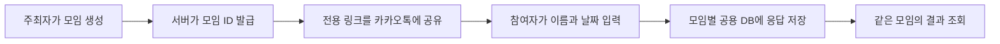

# 카카오톡에서 링크로 초대하는 일정 조율 흐름

## 첫 단계는 이름을 직접 입력받는다

카카오 로그인은 도입하지 않습니다. 이름은 화면의 표시용이며 본인 인증 수단이 아닙니다. 현재 데모의 기존 참여자 선택은 가상 응답을 불러와 수정하는 체험 기능입니다.

## 링크 전달과 여러 사람의 응답 저장은 별개의 기능이다

현재 GitHub Pages 데모는 각 브라우저 안에서 독립적으로 동작합니다. 데모 주소를 카카오톡으로 보내는 것은 가능하지만, 받은 사람의 입력이 보낸 사람의 결과에 합쳐지지는 않습니다.

실제 서비스로 확장할 때 필요한 구조는 다음과 같습니다.

이 구조의 공용 DB와 모임 생성 기능은 **구현 계획**입니다.

## 우리 모임 ID로 참여자와 응답을 나눈다

| 정보 | 역할 |
| --- | --- |
| 모임 ID | 이름 목록과 응답이 속하는 모임을 구분합니다. |
| 참여자 ID | 이름이 바뀌어도 같은 응답을 찾기 위한 내부 식별자입니다. |
| 수정 권한 | 실제 서비스에서는 별도 토큰 등으로 소유자를 확인해야 합니다. 이름만으로 수정 권한을 부여하지 않습니다. |
| 날짜별 응답 | 가능 / 불가를 저장하고 비어 있으면 미정으로 계산합니다. |

링크에 모임 ID를 포함합니다. 같은 링크는 어느 단톡방에서 열어도 같은 모임을 가리킵니다. 카톡방별로 취합을 분리하려면 모임을 따로 만들고 각 링크를 보내야 합니다.

## 카카오톡 공유 API는 링크가 담긴 카드 메시지를 전달한다

웹에 공유 버튼을 붙이면 사용자가 친구나 채팅방을 직접 선택해 링크를 보낼 수 있습니다. 카톡 메시지 안에 달력 입력 화면을 넣는 것이 아니라, 버튼으로 웹을 열어 입력하게 합니다.

- 일반 단톡방의 `/일정`을 이 서비스의 실행 명령으로 등록하지 않습니다.
- 공유 API로 단톡방 전체 명단이나 접속한 사람의 이름을 자동 취득하지 않습니다.
- 별도 카카오 로그인을 붙이면 동의한 본인의 프로필 정보를 조회할 수 있지만, 이번 범위에서는 제외합니다.
- 공유 완료 웹훅의 `HASH_CHAT_ID`는 참고용 식별자입니다. 우리 모임 ID와 함께 기록할 수 있으나 모임을 구분하는 기본 키로 삼지 않습니다.

[카카오톡 공유 소개](https://developers.kakao.com/docs/ko/kakaotalk-share/common) · [JavaScript SDK](https://developers.kakao.com/docs/ko/kakaotalk-share/js-link) · [공유 완료 웹훅](https://developers.kakao.com/docs/ko/kakaotalk-share/callback)

## 정적 배포 이후에는 공용 저장과 수정 권한을 먼저 검증한다

1. 모임별 데이터가 서로 섞이지 않는 서버 저장 구조
2. 이름과 응답의 조회·수정 권한
3. 동시 저장과 변경 내역의 반영
4. 지난달 응답 보존·삭제 정책의 서버 적용
5. 실제 사용자와 조율 시간·혼동·응답 누락 비교

초기 시제품에 채팅방 자동 분석, 로그인, 알림, AI 기능을 추가하지 않습니다. 먼저 명시적인 날짜 입력과 취합 흐름의 유용성을 확인합니다.
